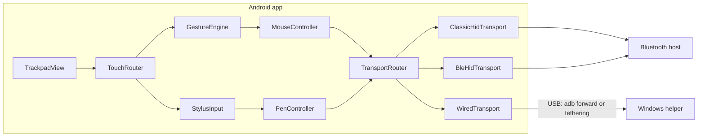
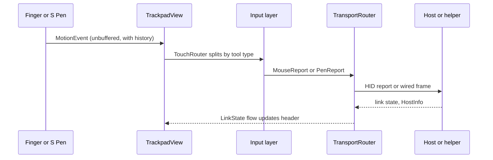

<!-- architecture.md: shared contracts for the PadLink trackpad, pen, transports, and Windows helper. -->

# System Architecture

## Purpose and authority

This document owns every rule that two or more blueprint responsibilities must obey. Responsibility-local behavior lives in the blueprints listed in the [blueprint manifest](blueprints/README.md). Inspected code and tests override stale prose; when they disagree with this document, fix one of them in the same change.

PadLink turns an Android phone (tuned for Galaxy S Ultra devices) into a virtual trackpad and a pressure-sensitive pen tablet for a computer.

## System boundaries

- **Android app** (`android/`): captures finger and S Pen input, converts it into the shared input model, and sends it over one active transport.
- **Bluetooth host**: any computer that pairs with the phone. It receives standard HID reports and needs no PadLink software.
- **Windows helper** (`helper/`): a Rust tray program that receives the wired protocol over USB and injects mouse and pen input into Windows.
- **Excluded**: keyboard input screens, multimedia controls, air mouse, mouse jiggler, macOS or Linux helpers, and rooted USB gadget mode.

## Component model

Dependency direction is strictly left to right: UI depends on input, input depends on the transport interface, and transports depend only on the encoders in `hid/` and `wire/`. Transports never call back into UI code; they publish state through flows.

## Shared contracts

### Input event model

All transports consume the same two value types produced by the input layer.

- `MouseReport(buttons, dx, dy, wheel, pan)`
  - `buttons`: bit mask; bit 0 left, bit 1 right, bit 2 middle, bit 3 back, bit 4 forward.
  - `dx`, `dy`: relative pointer counts after speed and acceleration, as signed integers with no range limit. Positive `dx` is right; positive `dy` is down.
  - `wheel`: vertical scroll in 1/120 notch units (120 = one wheel notch). Positive scrolls content up (away from the user), matching Windows `WHEEL_DELTA`.
  - `pan`: horizontal scroll in 1/120 notch units. Positive scrolls right.
- `PenReport(flags, x, y, pressure, tiltX, tiltY, twist)`
  - `flags`: bit 0 in range (hover or contact), bit 1 tip contact, bit 2 barrel (side button), bit 3 eraser contact, bit 4 inverted (eraser hovering).
  - `x`, `y`: absolute position, 0..32767 across the active tablet area. 0,0 is top left of the area.
  - `pressure`: 0..4095, after the pressure curve. Must be 0 when the tip flag is clear.
  - `tiltX`, `tiltY`: degrees, -60..60. Positive `tiltX` leans right; positive `tiltY` leans toward the user.
  - `twist`: degrees, 0..359, clockwise from up.

Each transport converts these into its own encoding. No transport may reinterpret units.

### HID report contract

The Bluetooth transports register exactly one combined HID report descriptor (defined in `android/app/src/main/kotlin/dev/padlink/hid/HidDescriptor.kt`). Hosts cache it at pairing time, so changing it forces users to pair again and requires a version note in the blueprint.

| Report ID | Collection | Input payload (little-endian) |
|---|---|---|
| 1 | Keyboard | modifiers u8, reserved u8, 5 key codes (7 bytes) |
| 2 | Mouse | buttons u8 (5 bits + 3 padding), x i8, y i8, wheel i8, AC Pan i8 (5 bytes) |
| 3 | Consumer control | 12-bit usage + 4 bits padding (2 bytes) |
| 4 | Pen digitizer | flags u8 (tip, barrel, eraser, invert, in range + 3 padding), x u16, y u16, pressure u16, tiltX i8, tiltY i8 (9 bytes) |

- Mouse deltas larger than ±127 are split into consecutive reports with the same button mask; wheel and pan whole notches ride in the first report and fractional notches carry into the next event.
- SDP identity: name "PadLink", description "Android trackpad and pen", provider "PadLink", subclass 0xC0 (combo).

### Wired protocol

The wired link is a single TCP connection. The phone is always the server on port **47800**; the helper is always the client.

- **Framing**: `len u16 | type u8 | payload`, big-endian. `len` counts the type byte plus the payload. Maximum `len` is 512.
- **Frames**:

| Type | Name | Direction | Payload |
|---|---|---|---|
| 0x01 | Hello | helper to phone | version u8, helper token 16 bytes, name length u8, name UTF-8 |
| 0x02 | Welcome | phone to helper | version u8, status u8 (0 ok, 1 pairing required, 2 rejected, 3 version mismatch) |
| 0x03 | PairCode | phone to helper | code u32 (six decimal digits) |
| 0x04 | HostInfo | helper to phone | width u16, height u16 (pixels of the pen target monitor) |
| 0x10 | Mouse | phone to helper | buttons u8, dx i16, dy i16, wheel i16, pan i16 |
| 0x11 | Pen | phone to helper | flags u8, x u16, y u16, pressure u16, tiltX i8, tiltY i8, twist u16 |
| 0x20 | Ping | either | nonce u32 |
| 0x21 | Pong | either | nonce u32 (echo) |
| 0x30 | Bye | either | none |

- Protocol version is **1**. A peer that receives an unknown frame type ignores it; a version mismatch closes the link after Welcome status 3.
- Mouse `dx`/`dy`/`wheel`/`pan` saturate at the i16 range; the sender splits larger values into several frames.
- `TCP_NODELAY` is enabled on both ends. Either side sends Ping every 1 s and treats 3 s without any received frame as a lost link.
- Golden vectors live in [protocol/test-vectors.txt](protocol/test-vectors.txt); the Kotlin and Rust codecs must both pass them.

### Transport selection

- The user picks one transport in the header picker: **Bluetooth** (a bonded host), **USB (ADB)**, or **USB (Tethering)**. Only one transport is active at a time; switching stops the previous one first.
- Bluetooth sub-mode (setting `bt_mode`): `auto` tries Classic HID and falls back to BLE when the HID Device profile proxy is unavailable or app registration fails; `classic` and `ble` force one stack.
- USB (ADB): the server binds to loopback only; the helper runs `adb forward tcp:47800 tcp:47800`.
- USB (Tethering): the server binds the IPv4 address of the USB tether interface (`rndis*`, `ncm*`, `usb*`), and the helper connects to its tether adapter's gateway. A second listener on loopback accepts a helper that arrives through `adb forward`; that helper skips pairing, because USB debugging authorization already vouches for the computer. The phone never listens on other interfaces.

### Connection state model

Every transport publishes one `LinkState`:

| Status | Meaning | Header text |
|---|---|---|
| `Idle` | transport not started or no target chosen | "no device" |
| `Connecting` | trying to reach the target | "connecting" |
| `Connected` | reports are being delivered | "connected" |
| `Disconnected` | target known but not reachable; retrying | "disconnected" |
| `ProfileNotConnected` | Bluetooth link is up but the host has not enabled the HID profile | "disconnected" plus the "connection needs update" card |
| `PairingRequest` | a wired helper awaits approval (carries code and host name) | "pairing" plus the approval dialog |
| `Unavailable` | the stack cannot run (radio off, permission missing, profile taken) | "unavailable" plus the reason |

### Input delivery and release semantics

- Each transport owns one sender thread fed by an outbox. Consecutive mouse reports with the same button mask merge by summing deltas; consecutive pen reports with identical flags collapse to the newest. Any change in buttons or pen flags is a barrier that is never merged away.
- When a link drops or the transport stops, held state is released: the phone sends an all-zero mouse report and an out-of-range pen report where the link still allows it, and the helper independently releases all buttons and lifts the pen when the connection closes.

### Settings contract

Settings are one `SharedPreferences` file named `settings`, owned by `android/app/src/main/kotlin/dev/padlink/settings/SettingsStore.kt`. Keys inherited from the original app keep their names and defaults:

| Key | Type | Default |
|---|---|---|
| `mouse_pointer_speed` | int 0..100 | 50 |
| `mouse_scroll_speed` | int 0..100 | 50 |
| `mouse_invert_scroll` | boolean | false |
| `touch_click_enabled` | boolean | true |
| `show_mouse_buttons` | string set {`top`,`bottom`} | {`bottom`} |
| `visible_mouse_buttons` | string set {`left`,`middle`,`right`} | {`left`,`right`} |
| `show_scroll_bar` | string set {`left`,`right`} | {`right`} |
| `haptic_feedback` | boolean | true |
| `keep_screen_on` | boolean | false |

New keys: `transport` (`bluetooth`/`usb_adb`/`usb_tether`, default `bluetooth`), `bt_mode` (`auto`/`classic`/`ble`, default `auto`), `bt_target` (device address), `pen_mode` (`tablet`/`pointer`, default `tablet`), `pen_aspect` (`auto`/`16:9`/`16:10`/`3:2`/`21:9`/`stretch`, default `auto`), `pen_area` (int 50..100, default 100), `pen_pressure` (`soft`/`normal`/`firm`, default `normal`), `pen_side_button` (`barrel`/`eraser`, default `barrel`), `approved_helpers` (string set of hex tokens), `samsung_hint_dismissed` (boolean, default false).

### Wired pairing and trust

- ADB links need no PadLink pairing: USB debugging authorization already proves physical access.
- Tethering links require approval. The helper keeps a random 16-byte token in `%APPDATA%\PadLink\helper-token`. If the token is not in `approved_helpers`, the phone answers Welcome status 1, sends PairCode, and shows an approval dialog with the same six-digit code the helper displays. Approval stores the token and sends Welcome status 0; denial sends status 2 and closes.
- While pairing is pending, the helper sends nothing and suspends Ping and its link timeout until the final Welcome. The phone treats any received byte or a closed socket as cancellation and gives up after 60 s.

## Cross-cutting flows

## Verification boundaries

- GitHub Actions CI is the only build authority (see [CI pipeline](blueprints/ci-pipeline.md)).
- Unit tests establish: gesture, acceleration, stylus routing and mapping, outbox merging, HID descriptor sizes and report encoding, and wired codec golden vectors (Kotlin and Rust).
- Radio, USB, and Windows injection behavior can only be verified on real hardware; blueprints record those results as manual acceptance.

## Feature blueprints

See [the blueprint manifest](blueprints/README.md).
